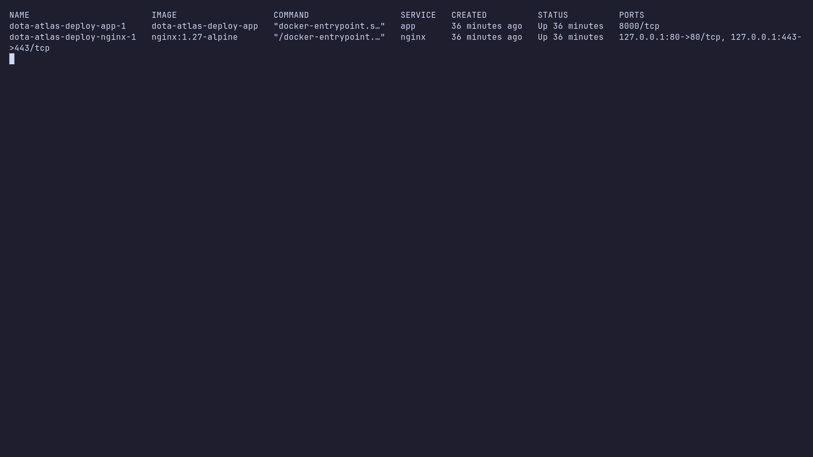
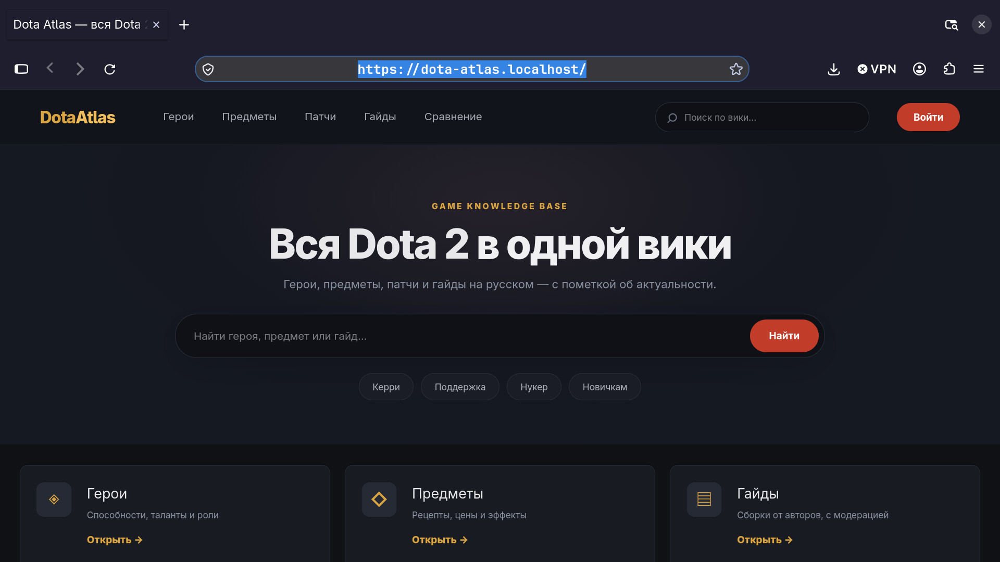
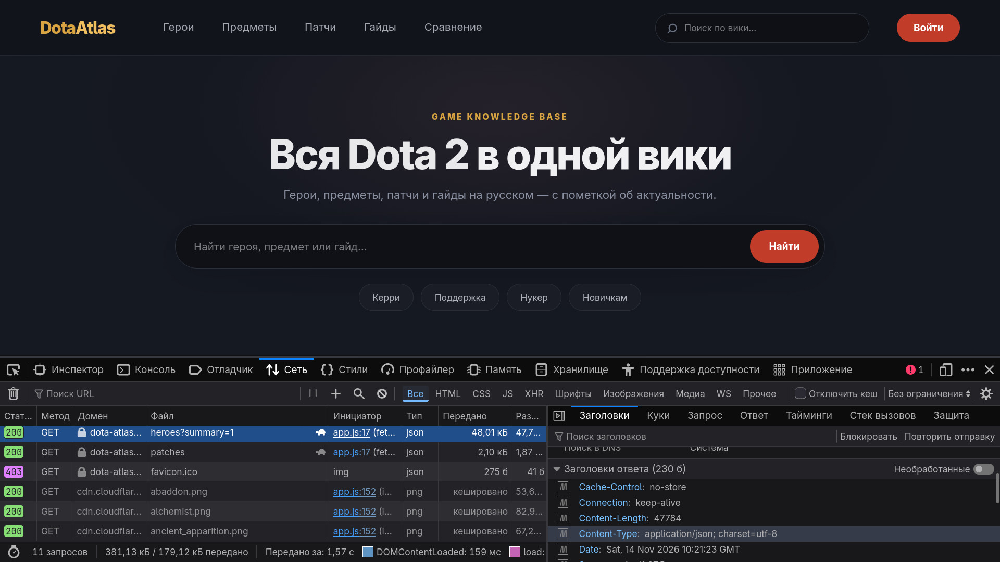
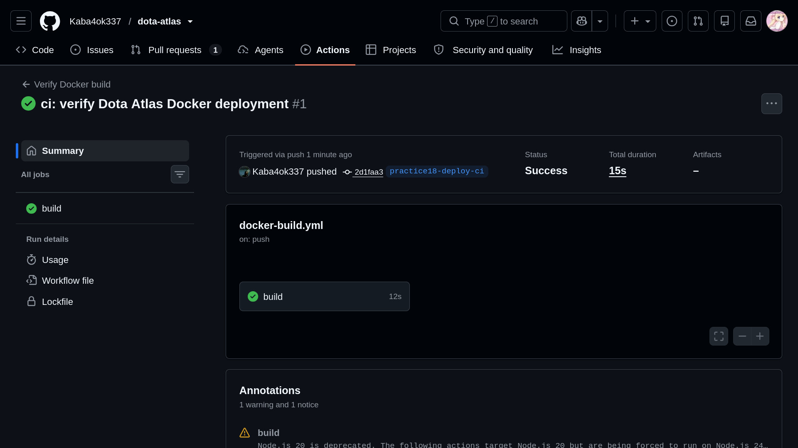

# Практическая работа №18 — локальная репетиция деплоя Dota Atlas

Приложение запускается на локальном компьютере, а данные остаются в существующей Supabase PostgreSQL. Репетиция не включает публикацию сайта в интернете. Имя и номер группы необходимо добавить перед сдачей.

## Архитектура

```text
Браузер → HTTPS → nginx → Node.js (сайт и API) → Supabase PostgreSQL
               Docker Compose                    внешний сервис
```

| Сервис | Технология | Внутренний порт | Продакшен-сервер и назначение |
| --- | --- | --- | --- |
| nginx | nginx | 80 и 443 | HTTPS, перенаправление HTTP и обратный прокси |
| app | Node.js | 8000 | Статические файлы, страницы и API |
| Supabase | PostgreSQL | 5432 или порт pooler | Внешняя база данных |

Только nginx публикует порты и только на `127.0.0.1`. Приложение и база не публикуются через Docker. Для подключения к Supabase нужен интернет.

## Переменные окружения

- `DATABASE_URL` — строка подключения к существующей Supabase из корневого `.env`, секрет.
- `SITE_URL` — локальный адрес сайта, задан в Compose.
- `HOST`, `PORT`, `NODE_ENV` — настройки запуска Node.js, заданы в Dockerfile.

Не добавляйте `.env`, закрытые ключи и сертификаты в Git. При использовании Supabase строка подключения должна быть доступна из контейнера; иногда необходим Session pooler.

## Подготовка

Требуются работающий Docker с Compose, доступ текущего пользователя к демону Docker и установленный `mkcert`. Папки `dota-atlas-practice` и `DotaCodex_project` должны находиться рядом; в корне проекта должен находиться `.env` с существующей `DATABASE_URL`. Исходный код для этой работы опубликован в [ветке practice18-deploy-ci](https://github.com/Kaba4ok337/dota-atlas/tree/practice18-deploy-ci); при другом расположении каталогов измените пути в `docker-compose.yml`. Команды ниже выполняются из папки `dota-atlas-practice/deploy`:

```bash
mkdir -p certs
mkcert -install
mkcert -cert-file certs/dota-atlas.localhost.pem \
  -key-file certs/dota-atlas.localhost-key.pem dota-atlas.localhost
docker compose up --build -d
docker compose ps
```

Откройте <https://dota-atlas.localhost>. `mkcert -install` может запросить права для добавления локального центра сертификации в доверенные. При занятом порте 80 или 443 необходимо освободить его или изменить настройки портов и адреса.

Проверка и остановка:

```bash
docker compose logs
curl -I http://dota-atlas.localhost
curl -i https://dota-atlas.localhost/api/health
docker compose down
```

## CI

В [ветке приложения](https://github.com/Kaba4ok337/dota-atlas/tree/practice18-deploy-ci) файл `.github/workflows/docker-build.yml` проверяет сборку образа при push, pull request и ручном запуске. Он не требует секретов и не публикует образ. [Проверка сборки прошла успешно](https://github.com/Kaba4ok337/dota-atlas/actions/runs/43585274119). Существующий workflow `ci.yml` в этой ветке переведён на ручной запуск: его шаг `db:setup` изменяет указанную в секрете базу, поэтому используйте для него отдельную учебную базу.

## Подтверждения для отчёта

Вывод `docker compose ps` с состоянием и портами контейнеров:



Главная страница через HTTPS:



Запрос API в Network и заголовки ответа:



Успешная сборка в GitHub Actions:



### Состояние проверки

- Образ приложения собран; контейнеры app и nginx запущены, порты nginx привязаны к `127.0.0.1`.
- HTTP перенаправляет на HTTPS, главная страница отвечает 200, сертификат проходит системную проверку, заголовок `X-Robots-Tag` присутствует.
- После возобновления проекта Supabase запросы к `/api/health`, `/api/heroes?summary=1` и `/api/patches` возвращают 200.
- GitHub Actions успешно собрал Docker-образ в отдельной ветке. Снимок списка контейнеров сделан через Docker Compose в терминале; отдельный снимок Docker Desktop не подготовлен, поскольку его установка конфликтует с установленными пакетами Docker Compose и Buildx.

### Ошибки и решения

- Docker был остановлен и доступ к его сокету требовал прав администратора. Служба Docker запущена; команды можно выполнять с `sudo`.
- Экспериментальный пакет Docker Desktop для Arch не установился из-за конфликта файлов с пакетами `docker-compose` и `docker-buildx`. Текущий Docker Engine и контейнеры сохранены; список контейнеров и портов подтверждён выводом Docker Compose.
- Supabase была приостановлена, из-за чего API отвечал 500 и pooler сообщал, что tenant не найден. После возобновления проекта API снова отвечает 200.
- Для API следует проверять GET-запрос командой `curl -i`, поскольку запрос HEAD через `curl -I` для этого маршрута возвращает 404.

Для реального сервера потребуются хостинг, домен и DNS, публичный TLS-сертификат, настройка секретов и безопасная доставка изменений; также необходимо отдельно оценить безопасность и размещение данных.
